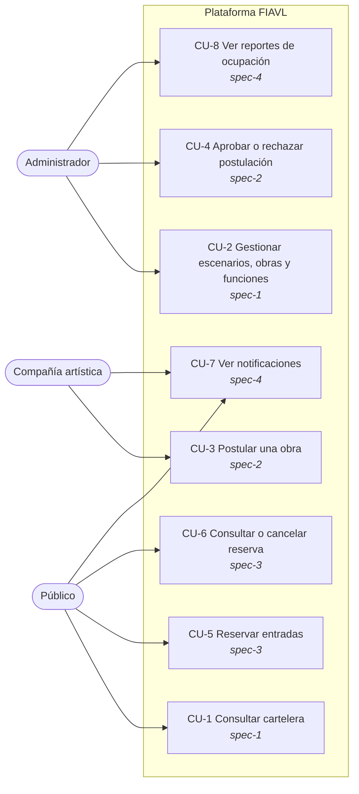
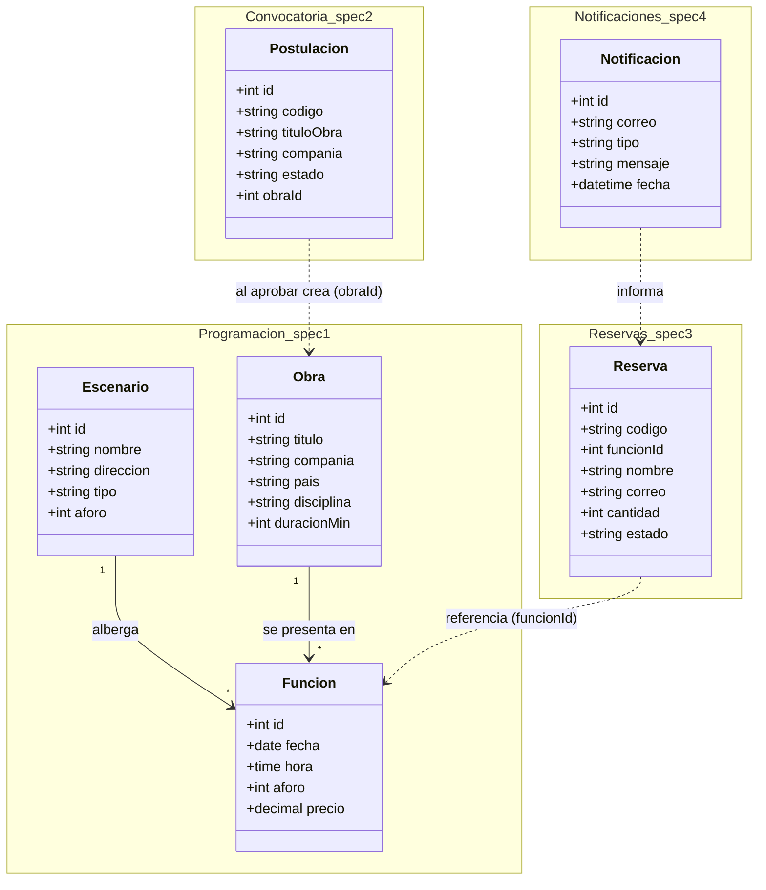
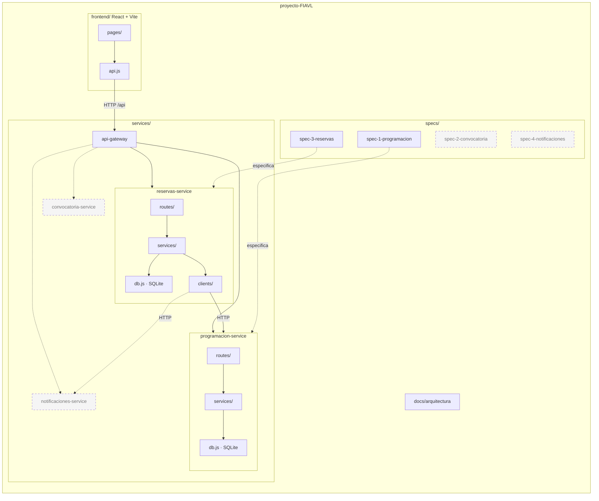
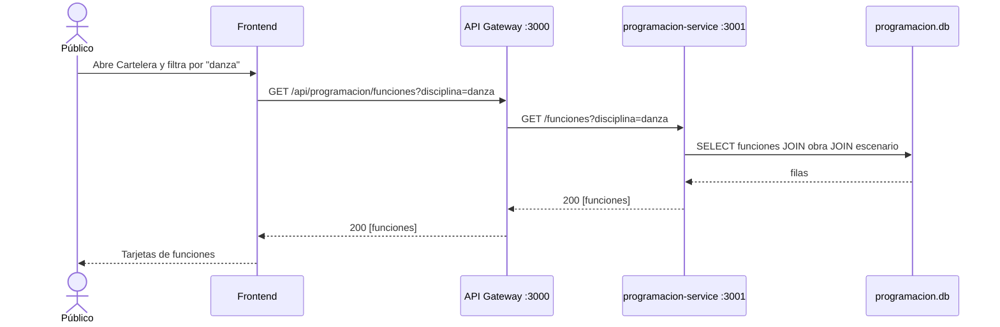
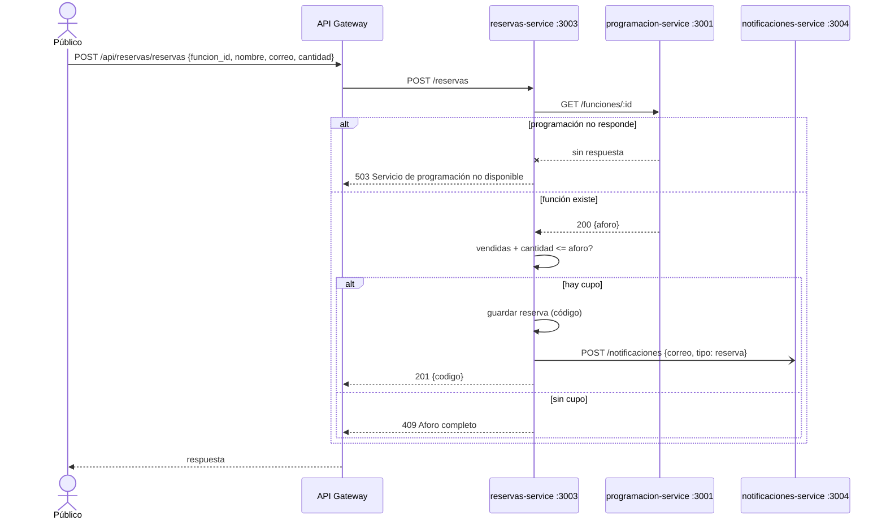
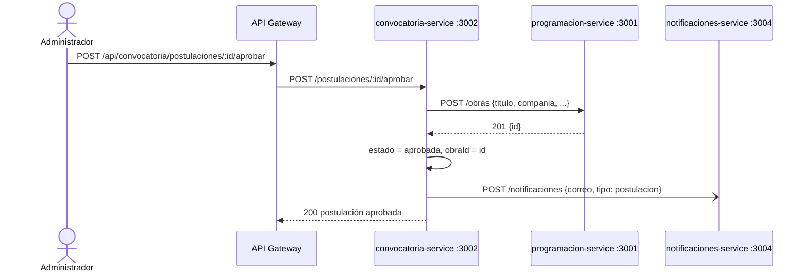
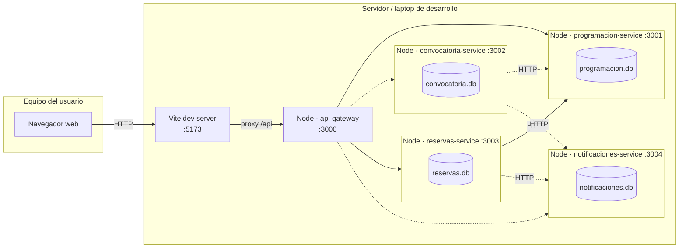

# Arquitectura FIAVL — Modelo 4+1

- **Estilo:** Microservicios con API Gateway
- **Estado:** spec-1 y spec-3 implementadas · spec-2 y spec-4 planificadas
  (en los diagramas, las líneas punteadas son lo que falta implementar)

| Vista | Pregunta que responde | Interesado principal |
|---|---|---|
| [+1 Escenarios](#1-vista-de-escenarios-1) | ¿Qué hace el sistema? | Usuarios, todo el equipo |
| [Lógica](#2-vista-lógica) | ¿Qué partes del dominio existen? | Analistas, desarrolladores |
| [Desarrollo](#3-vista-de-desarrollo) | ¿Cómo está organizado el código? | Desarrolladores |
| [Procesos](#4-vista-de-procesos) | ¿Cómo colaboran en tiempo de ejecución? | Integradores |
| [Física](#5-vista-física) | ¿Dónde se ejecuta cada parte? | Operaciones |

---

## 1. Vista de escenarios (+1)

Casos de uso principales y la spec responsable de cada uno.

**Escenario clave que recorre todas las vistas — "Reservar una entrada":**
el público ve una función en la cartelera (spec-1), reserva 2 entradas
(spec-3), reservas verifica el aforo con programación (spec-1) y, al
confirmar, se registra una notificación (spec-4).

---

## 2. Vista lógica

Cada microservicio es un **contexto delimitado** (bounded context) dueño de sus
entidades. Las relaciones entre contextos son **por id**, nunca por clave
foránea entre bases de datos.

---

## 3. Vista de desarrollo

Organización del repositorio: un paquete independiente por servicio, cada uno
con las mismas capas internas (rutas → servicios de negocio → datos).

| Paquete | Rama | Dependencias |
|---|---|---|
| `services/api-gateway` | spec-1 | express, http-proxy-middleware |
| `services/programacion-service` | spec-1 | express, better-sqlite3 |
| `services/convocatoria-service` | spec-2 | express, better-sqlite3 |
| `services/reservas-service` | spec-3 | express, better-sqlite3 |
| `services/notificaciones-service` | spec-4 | express, better-sqlite3 |
| `frontend` | compartido | react, vite |

---

## 4. Vista de procesos

### 4.1 Consultar la cartelera (implementado)

### 4.2 Reservar entradas (spec-3 + spec-1 + spec-4) (implementado, salvo spec-4)

### 4.3 Aprobar una postulación (spec-2 + spec-1)

---

## 5. Vista física

Despliegue en el entorno de desarrollo: cada servicio es un proceso Node.js
independiente con su propio archivo de base de datos.

En producción, cada nodo podría ser un contenedor distinto; como solo se
comunican por HTTP, basta con cambiar las URLs en las variables de entorno del
gateway (`PROGRAMACION_URL`, `RESERVAS_URL`, ...).

---

## Decisiones arquitectónicas

Ver [decisiones.md](decisiones.md).
