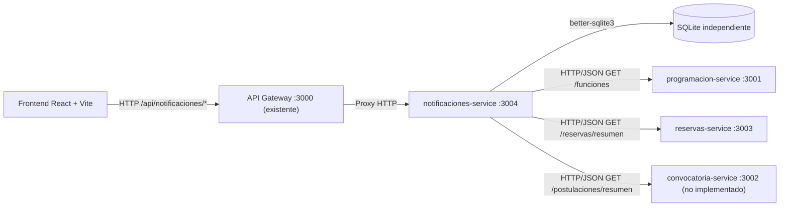
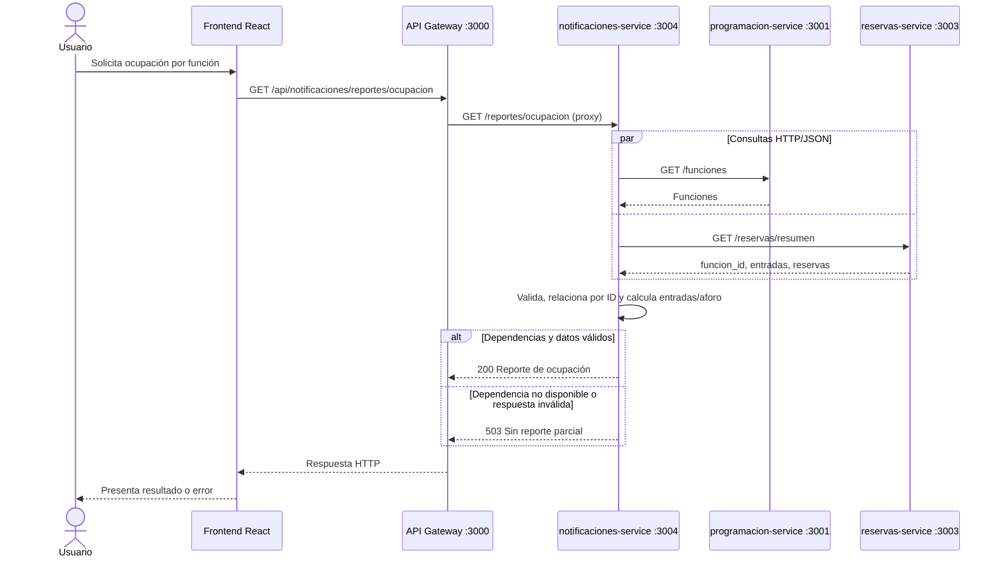

# notificaciones-service

Microservicio Express de SPEC-4. Usa una base SQLite independiente con
`better-sqlite3`, ofrece la API de notificaciones y genera reportes consultando
los otros microservicios exclusivamente por HTTP/JSON.

## Requisitos

- Node.js 20 o superior.
- Dependencias instaladas desde este directorio con `npm install`.

## Configuración

Las variables se leen de `process.env`, siguiendo el patrón de los servicios
existentes. `.env.example` es una plantilla; el servicio no carga `.env`
automáticamente.

| Variable | Predeterminado | Descripción |
|---|---|---|
| `PORT` | `3004` | Puerto del servidor Express |
| `DATABASE_PATH` | `notificaciones.db` | Archivo SQLite; las rutas relativas se resuelven desde este paquete |
| `PROGRAMACION_URL` | `http://localhost:3001` | URL base de programacion-service |
| `RESERVAS_URL` | `http://localhost:3003` | URL base de reservas-service |
| `CONVOCATORIA_URL` | `http://localhost:3002` | URL base de convocatoria-service |
| `SERVICE_TIMEOUT_MS` | `5000` | Timeout por solicitud HTTP a una dependencia |

En PowerShell, por ejemplo:

```powershell
$env:PORT = "3004"
$env:DATABASE_PATH = "notificaciones.db"
$env:PROGRAMACION_URL = "http://localhost:3001"
$env:RESERVAS_URL = "http://localhost:3003"
$env:CONVOCATORIA_URL = "http://localhost:3002"
$env:SERVICE_TIMEOUT_MS = "5000"
```

## Ejecución y pruebas

```powershell
npm install
npm start
npm test
```

El servidor inicializa la base al arrancar. La conexión SQLite se cierra al
recibir `SIGINT` o `SIGTERM`. Las pruebas crean sus propias bases temporales y
las eliminan al terminar.

## Endpoints

| Método | Ruta | Resumen |
|---|---|---|
| GET | `/health` | Estado del proceso |
| POST | `/notificaciones` | Registra una notificación |
| GET | `/notificaciones?correo=` | Consulta la bandeja de un correo |
| GET | `/reportes/ocupacion` | Ocupación por función |
| GET | `/reportes/funciones-mas-reservadas` | Entradas y reservas ordenadas por entradas |
| GET | `/reportes/postulaciones-por-estado` | Conteos publicados por convocatoria |

El API Gateway es el acceso del frontend. Si una dependencia falla, excede el
timeout o entrega datos incompatibles, el reporte responde HTTP 503 con
`{ "error": "..." }`; no se devuelve un reporte parcial.

## Arquitectura



## Secuencia: reporte de ocupación



## Contratos y limitaciones de integración

- La respuesta de la lista `GET /funciones` se consume usando únicamente los
  campos verificados en la implementación actual: `id`, `fecha`, `hora`,
  `aforo`, `obra.titulo` y `escenario.nombre`. El contrato de SPEC-1 todavía no
  formaliza la respuesta de lista; su confirmación por el propietario sigue
  pendiente antes de considerar esa dependencia contractual cerrada.
- convocatoria-service no está implementado en el repositorio. El cliente y
  las pruebas usan su contrato publicado; el servicio real debe responder
  HTTP 503 hasta que esté disponible. No se verificó una integración real con
  convocatoria.
- Para postulaciones se valida que `pendiente`, `aprobada`, `rechazada` y
  `total` sean enteros no negativos. SPEC-4 no establece una regla aritmética
  para recalcular `total`, por lo que se conserva el valor publicado por la
  dependencia.
- Las pruebas de reportes usan clientes simulados y servidores HTTP locales;
  no acceden a bases de datos externas ni requieren conexión a Internet.

## Verificación ejecutada

- `npm test`: 37 pruebas aprobadas, 0 fallidas.
- Smoke test del proceso real en el puerto 3004: `GET /health`, registro y
  consulta de notificaciones, y HTTP 503 seguro para un reporte con las
  dependencias configuradas como no disponibles.
- No se ejecutó integración real con los microservicios externos ni a través
  del API Gateway.

## Esquema persistido

La tabla `notificacion` contiene `id`, `correo`, `tipo`, `referencia`,
`mensaje` y `fecha_creacion`. El índice
`idx_notificacion_correo_fecha` acelera la bandeja por correo y fecha.
`tipo` es texto extensible; los alias provisionales se normalizan en la capa
de negocio.
