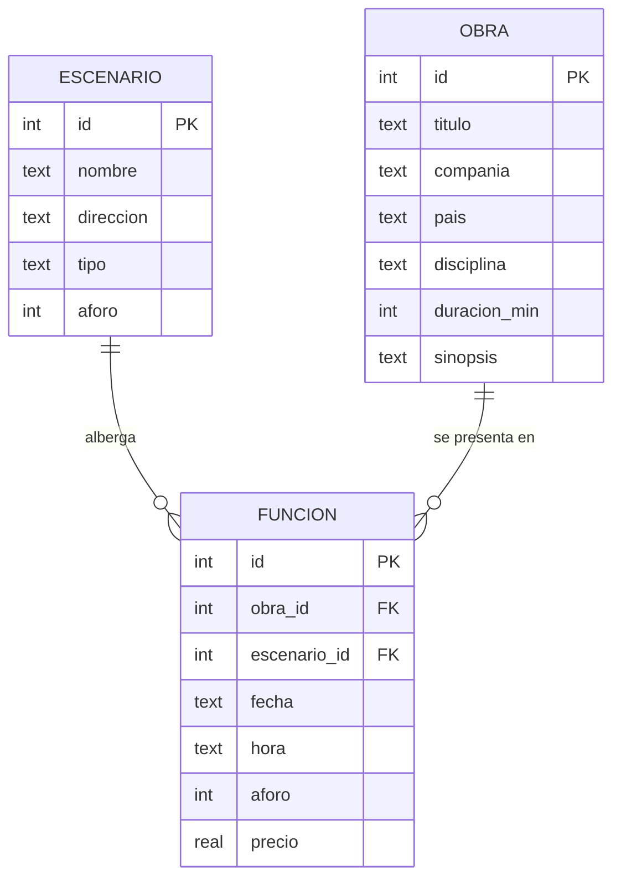

# Plan técnico — Spec-1: Programación del festival

## 1. Decisiones técnicas

| Decisión | Elección | Motivo |
|---|---|---|
| Estilo | Microservicios + API Gateway | Cada integrante es dueño de un servicio desplegable por separado; aislamiento de fallos; encaja con el trabajo por ramas |
| Runtime | Node.js 20+ con Express | Ligero, mismo lenguaje en todo el equipo |
| Persistencia | SQLite con `better-sqlite3` | Base por servicio sin instalar un motor de BD |
| Gateway | Express + `http-proxy-middleware` | Punto único de entrada; el frontend no conoce los puertos internos |
| Frontend | React + Vite | Rápido de levantar; recarga en caliente |
| Comunicación | REST síncrono (HTTP/JSON) | Simple de probar y de explicar; suficiente para el volumen del prototipo |

## 2. Arquitectura del servicio (capas internas)

```
programacion-service/src/
├── index.js        # Arranque: crea la app y escucha en el puerto 3001
├── app.js          # Configura Express y monta las rutas
├── db.js           # Conexión SQLite, creación de tablas y datos de ejemplo
├── routes/         # Capa de presentación (HTTP)
│   ├── escenarios.js
│   ├── obras.js
│   └── funciones.js
└── services/       # Capa de negocio (validaciones y reglas)
    └── programacion.js
```

Las rutas solo traducen HTTP ↔ JSON; las reglas (cruce de horarios, periodo
del festival, disciplinas válidas) viven en `services/programacion.js`.

## 3. Modelo de datos (programacion.db)



## 4. API Gateway

| Ruta pública | Servicio destino |
|---|---|
| `/api/programacion/*` | `http://localhost:3001/*` |
| `/api/convocatoria/*` | `http://localhost:3002/*` (spec-2) |
| `/api/reservas/*` | `http://localhost:3003/*` (spec-3) |
| `/api/notificaciones/*` | `http://localhost:3004/*` (spec-4) |

Además expone `GET /api/health`, que indica qué servicios están arriba.
Si un servicio no responde, el gateway devuelve **503** con
`{ "error": "Servicio <nombre> no disponible" }`.

## 5. Contratos

Ver [contracts/programacion-api.md](contracts/programacion-api.md).

## 6. Frontend

- `CarteleraPage`: lista de funciones con filtros por día y disciplina.
- `AdminProgramacionPage`: formularios para crear escenarios, obras y funciones.
- Las páginas de spec-2, spec-3 y spec-4 se agregan en `frontend/src/pages/`
  y en el menú de `App.jsx`.

## 7. Cumplimiento de la constitución

- [x] Base de datos propia (Principio II.2)
- [x] Comunicación solo HTTP/JSON (II.3)
- [x] Frontend solo vía gateway (II.4)
- [x] Puertos asignados (IV)
