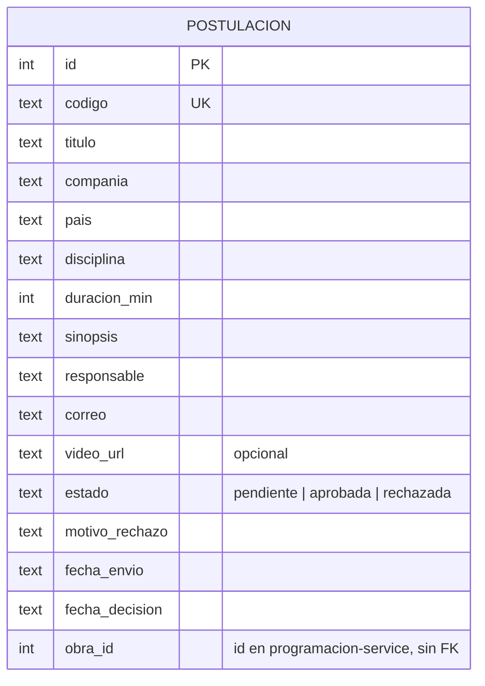
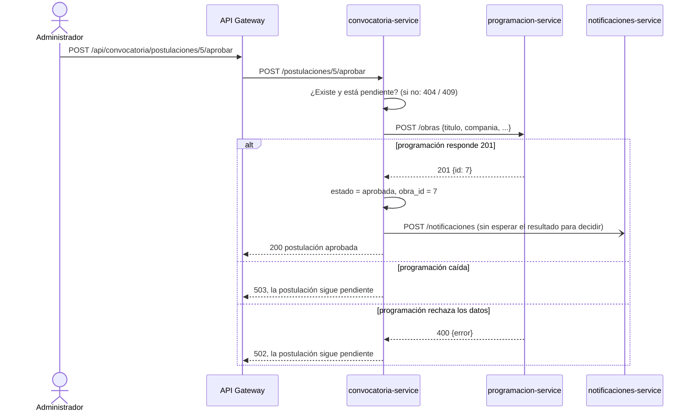

# Plan técnico — Spec-2: Convocatoria de artistas

## 1. Decisiones técnicas

Se respeta el stack común de la constitución (Principio III). Decisiones propias de esta spec:

| Decisión | Elección | Motivo |
|---|---|---|
| Identificadores | `id` numérico para administración y otros servicios; código `CONV-XXXXXX` solo para que la compañía consulte | Se respeta la ruta `/postulaciones/:id/aprobar` de la vista de procesos (docs/arquitectura, 4.3); el código público no revela cuántas postulaciones existen |
| Cambio de estado | Acciones explícitas `POST /:id/aprobar` y `POST /:id/rechazar` | Cada acción tiene reglas propias; evita que se pueda poner cualquier estado con un `PATCH` |
| Aprobación | Primero se crea la obra en programación y **solo si responde 201** se marca "aprobada" | Evita postulaciones aprobadas sin obra (FR-007) |
| Notificación | Llamada a spec-4 **después** de guardar la decisión, con tiempo límite de 2 s y sin propagar el error | Un fallo del aviso no deshace la decisión (FR-009) |
| Comunicación | REST síncrono con `fetch` nativo de Node 20 | No agrega dependencias |

## 2. Arquitectura del servicio (capas internas)

```
convocatoria-service/src/
├── index.js              # Arranque: escucha en el puerto 3002
├── app.js                # Configura Express, /health y monta las rutas
├── db.js                 # SQLite, creación de la tabla y datos de ejemplo
├── routes/
│   └── postulaciones.js  # Capa de presentación (HTTP ↔ JSON)
├── services/
│   └── convocatoria.js   # Reglas: validación, duplicados, aprobar, rechazar
└── clients/
    ├── programacion.js   # Llama a POST /obras (spec-1)
    └── notificaciones.js # Llama a POST /notificaciones (spec-4)
```

La carpeta `clients/` aísla las llamadas a otros servicios: si cambia un
contrato externo, solo se toca ese archivo.

## 3. Modelo de datos (convocatoria.db)



## 4. Flujo de aprobación



## 5. Contratos

- Publicado por esta spec: [contracts/convocatoria-api.md](contracts/convocatoria-api.md)
- Consumidos: `POST /obras` de spec-1 y `POST /notificaciones` de spec-4
  (formato confirmado con el contrato de spec-4).

## 6. Frontend

- `ConvocatoriaPage`: formulario público para postular y consulta por código (HU-1, HU-2).
- `AdminConvocatoriaPage`: lista con filtros, detalle, aprobar y rechazar con motivo (HU-3, HU-4, HU-5).
- Se agregan al menú de `App.jsx` y sus llamadas a `api.js`, siempre por `/api/convocatoria`.

## 7. Cambios en archivos compartidos

Estos archivos los tocan varias specs; hacer el cambio mínimo para evitar conflictos al integrar:

- `package.json` (raíz): agregar `convocatoria-service` a los scripts `instalar` y `dev`.
- `frontend/src/App.jsx` y `frontend/src/api.js`: agregar solo las entradas de spec-2.
- `docs/arquitectura/README.md`: pasar de punteado a sólido lo de spec-2.
- El gateway **no** necesita cambios: ya enruta `/api/convocatoria` al puerto 3002.

## 8. Riesgos conocidos

- **Doble aprobación simultánea:** si dos administradores aprueban la misma
  postulación al mismo tiempo, podrían crearse dos obras. Para el prototipo se
  acepta; la actualización usa `WHERE estado = 'pendiente'` para que al menos
  solo una quede registrada como aprobada.
- **Lista de disciplinas duplicada:** se copia de spec-1 porque los servicios no
  comparten código. Si spec-1 la cambia, hay que actualizarla aquí.

## 9. Cumplimiento de la constitución

- [x] Base de datos propia (Principio II.2)
- [x] Comunicación solo HTTP/JSON (II.3)
- [x] Frontend solo vía gateway (II.4)
- [x] 503 si una dependencia no responde (II.5)
- [x] Puerto 3002 (IV)
