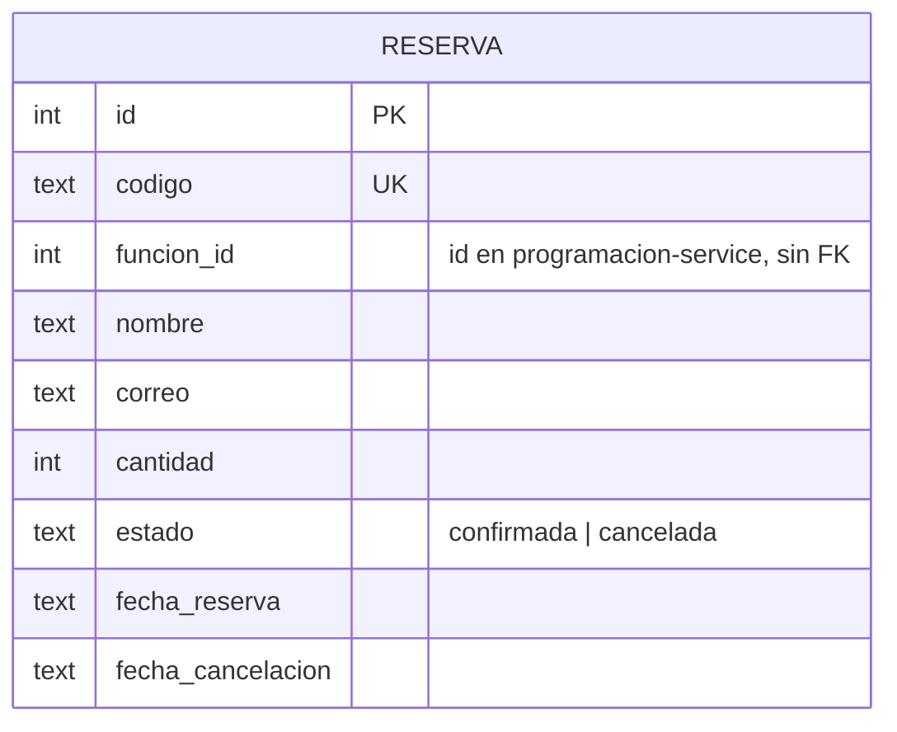
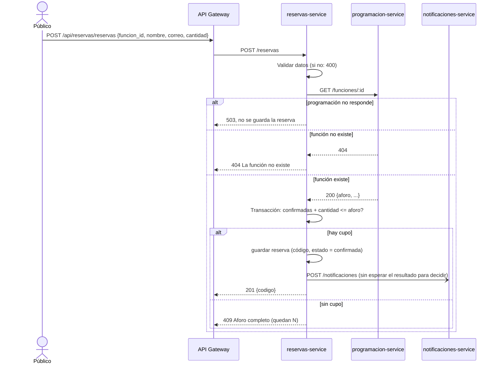

# Plan técnico — Spec-3: Entradas y reservas

## 1. Decisiones técnicas

Se respeta el stack común de la constitución (Principio III). Decisiones propias de esta spec:

| Decisión | Elección | Motivo |
|---|---|---|
| Identificadores | `id` numérico para otros servicios; código `RES-XXXXXX` para que el público consulte y cancele | Igual criterio que spec-2; el código público no revela cuántas reservas existen |
| Ruta de reserva | `POST /reservas` | Se respeta la ruta de la vista de procesos (docs/arquitectura, 4.2) |
| Cancelación | Acción explícita `POST /reservas/codigo/:codigo/cancelar` | El público solo conoce su código; evita poner cualquier estado con un `PATCH` |
| Control de aforo | Se pide el aforo a programación y luego, **en una sola transacción SQLite**, se suman las entradas confirmadas y se inserta la reserva | Evita que dos reservas simultáneas superen el aforo (FR-003) |
| Notificación | Llamada a spec-4 **después** de guardar la reserva, con tiempo límite de 2 s y sin propagar el error | Un fallo del aviso no deshace la reserva (FR-007) |
| Comunicación | REST síncrono con `fetch` nativo de Node 20 | No agrega dependencias |

## 2. Arquitectura del servicio (capas internas)

```
reservas-service/src/
├── index.js              # Arranque: escucha en el puerto 3003
├── app.js                # Configura Express, /health y monta las rutas
├── db.js                 # SQLite, creación de la tabla y datos de ejemplo
├── routes/
│   └── reservas.js       # Capa de presentación (HTTP ↔ JSON)
├── services/
│   └── reservas.js       # Reglas: validación, aforo, código, cancelar
└── clients/
    ├── programacion.js   # Llama a GET /funciones/:id (spec-1)
    └── notificaciones.js # Llama a POST /notificaciones (spec-4)
```

La carpeta `clients/` aísla las llamadas a otros servicios: si cambia un
contrato externo, solo se toca ese archivo.

## 3. Modelo de datos (reservas.db)



Las entradas disponibles de una función se calculan, no se guardan:
`disponibles = aforo (de spec-1) − SUM(cantidad) de reservas confirmadas`.

## 4. Flujo de reserva



## 5. Contratos

- Publicado por esta spec: [contracts/reservas-api.md](contracts/reservas-api.md)
- Consumidos: `GET /funciones/:id` de spec-1 y `POST /notificaciones` de spec-4
  (formato provisional, ver contrato; se ajusta cuando spec-4 publique el suyo).

## 6. Frontend

- `ReservasPage` ("Mis reservas", ya previsto en `App.jsx`): elegir una función
  de la cartelera (`/api/programacion/funciones`), formulario de reserva, y
  consulta y cancelación por código (HU-1 a HU-4).
- Sus llamadas van por `api.js`, siempre por `/api/reservas`.

## 7. Cambios en archivos compartidos

Estos archivos los tocan varias specs; hacer el cambio mínimo para evitar conflictos al integrar:

- `package.json` (raíz): agregar `reservas-service` a los scripts `instalar` y `dev`.
- `frontend/src/App.jsx`: descomentar solo la línea de spec-3 e importar `ReservasPage`.
- `docs/arquitectura/README.md`: pasar de punteado a sólido lo de spec-3.
- El gateway **no** necesita cambios: ya enruta `/api/reservas` al puerto 3003.

## 8. Riesgos conocidos

- **Aforo cambiado en programación:** si spec-1 reduce el aforo de una función
  después de que hay reservas, las existentes no se anulan; solo se bloquean
  reservas nuevas. Se acepta para el prototipo.
- **Acoplamiento temporal con spec-1:** si programación cae, no se puede
  reservar (503). Es la consecuencia aceptada en ADR-004.
- **Varias instancias del servicio:** la transacción solo protege el aforo
  dentro de un proceso con un único archivo SQLite, que es el caso del prototipo.

## 9. Cumplimiento de la constitución

- [x] Base de datos propia (Principio II.2)
- [x] Comunicación solo HTTP/JSON (II.3)
- [x] Frontend solo vía gateway (II.4)
- [x] 503 si una dependencia no responde (II.5)
- [x] Puerto 3003 (IV)
